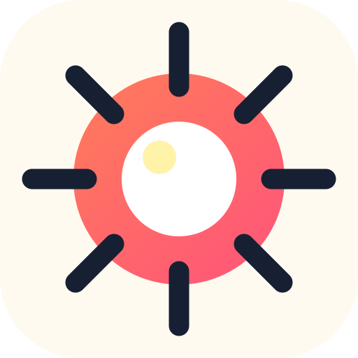
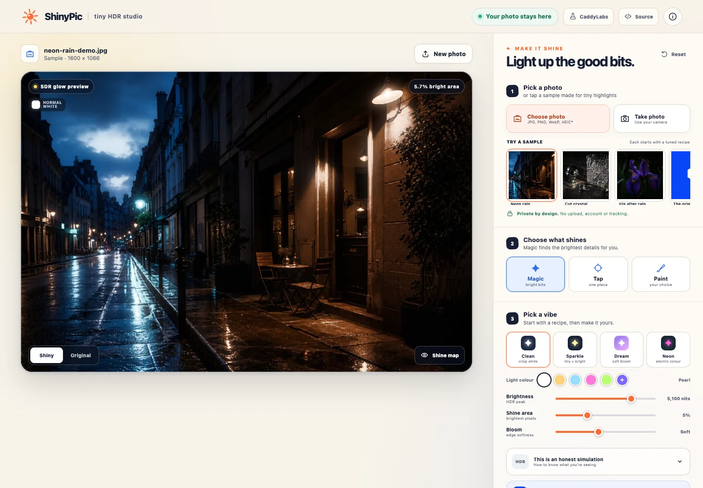
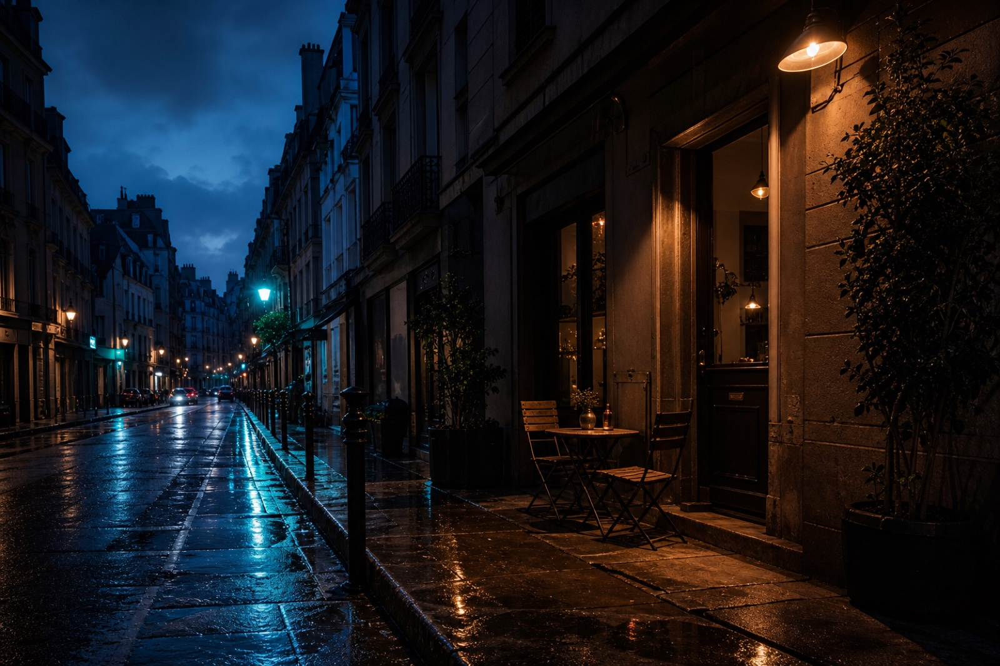
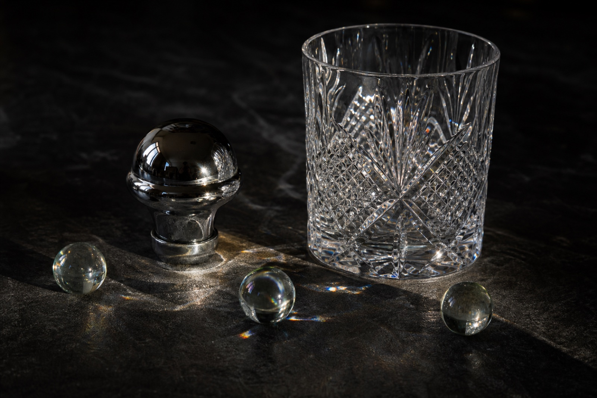
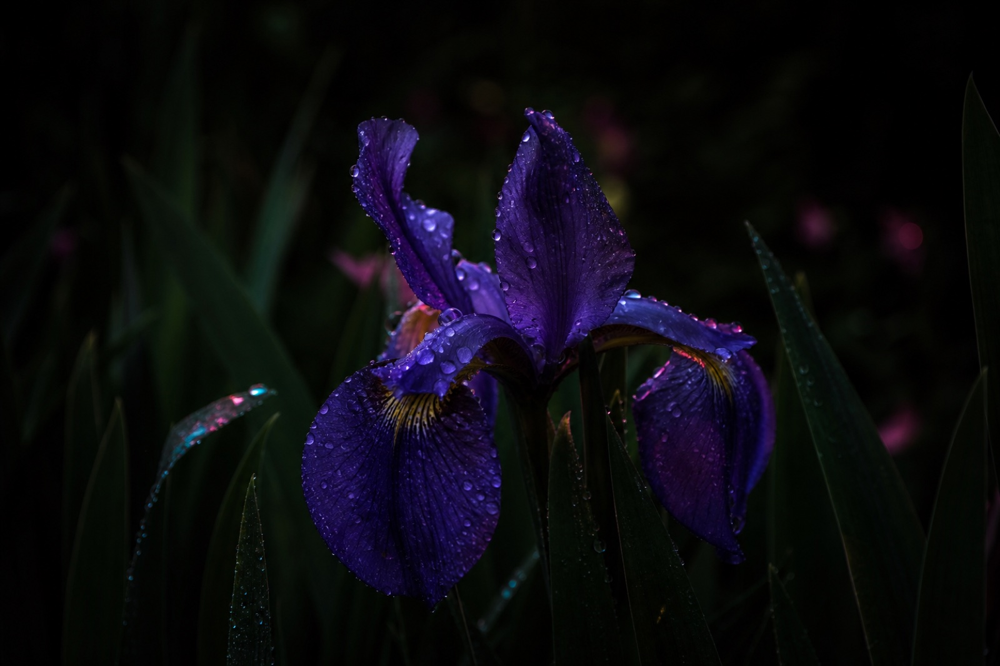
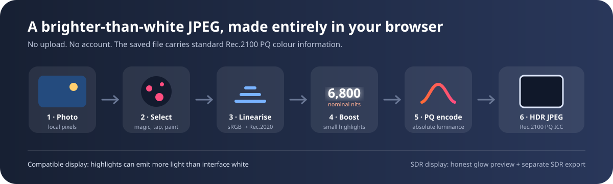
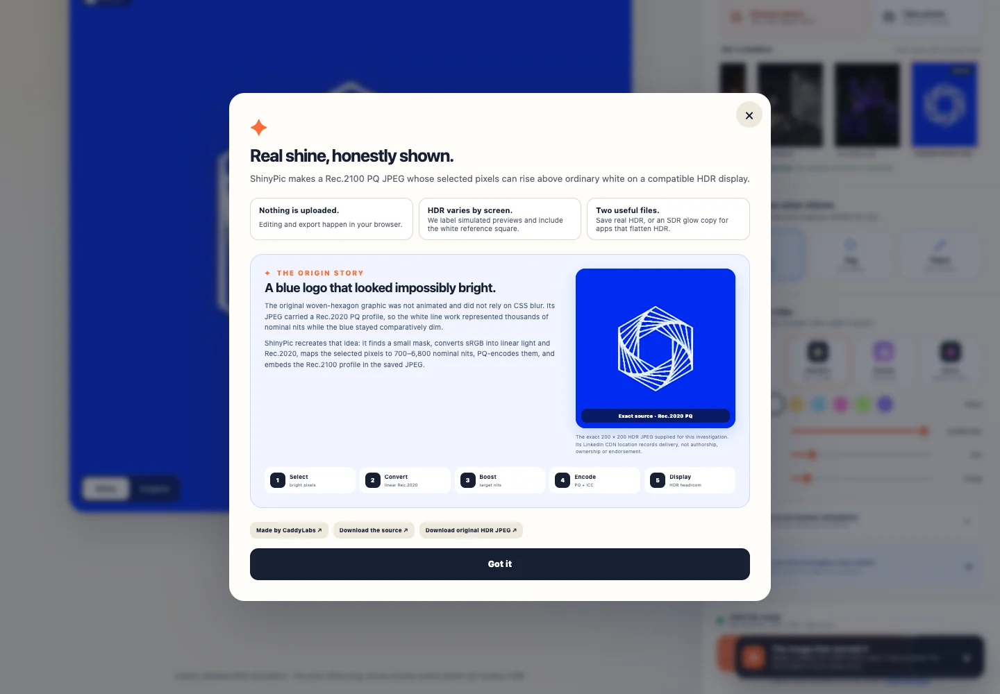
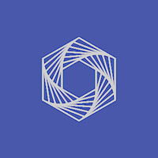
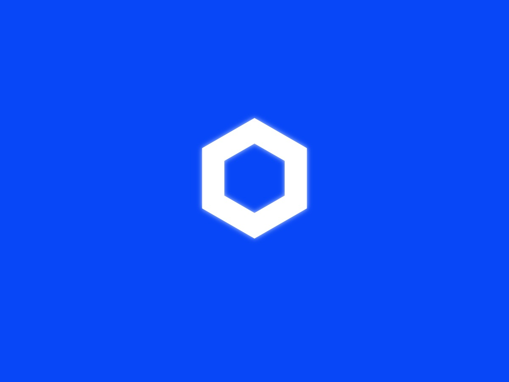
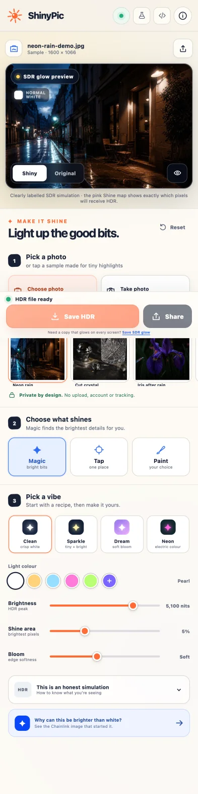

<p align="center">
  
</p>

<h1 align="center">ShinyPic</h1>

<p align="center"><strong>Turn the smallest bright details in a photo into real, brighter-than-white HDR.</strong></p>

<p align="center">
  <a href="https://shinypic.pages.dev/"><strong>Open the live demo</strong></a>
  ·
  <a href="https://github.com/peterhanily/shinypic/releases/latest/download/shinypic-standalone.html">Download the standalone page</a>
  ·
  <a href="https://caddylabs.io/">CaddyLabs</a>
</p>

<p align="center">
  <a href="https://github.com/peterhanily/shinypic/actions/workflows/ci.yml"></a>
</p>



ShinyPic is a zero-account, one-page editor for making Rec.2100 PQ HDR JPEGs.
Magic finds highlights, Tap targets one place, and Paint works with a finger,
mouse, or pen. Editing and export happen in the browser; there is no image API,
analytics SDK, ad tag, runtime package, or hidden upload.

## Why it feels different

| | ShinyPic |
| --- | --- |
| **Real HDR output** | Selected pixels can rise above ordinary interface white on a compatible display. |
| **Honest SDR behavior** | Unsupported screens get a clearly labelled glow simulation and a separate universal SDR export. |
| **Small creative surface** | Four recipes, Magic/Tap/Paint selection, five colour presets, a custom colour, and three useful sliders. |
| **Immediate saving** | The HDR JPEG is prepared after every edit; download and native sharing are first-class actions. |
| **Local-first** | Source pixels stay in browser memory. New JPEGs are canvas-rasterized, so source EXIF/GPS/XMP blocks are not copied. |
| **Portable** | Use the installable static PWA or one self-contained HTML file that opens from `file://`. |

The live application is static. Cloudflare necessarily receives ordinary HTTP
request metadata while serving its files, but ShinyPic has no application
backend and the code makes no request containing a selected photo.

## ShinyPic Arcade

[`arcade.html`](arcade.html) is a second page holding three games in which the
display itself is the game piece. All three are static, local-first and
dependency-free, and all three build their boards as lossless Rec.2100 PQ PNGs in
the browser.

| Game | What you do |
| --- | --- |
| **Fool's Gold** | A run of three boards that get dimmer, not longer. Twelve objects each time: four encoded above diffuse white, eight counterfeits built from the SDR vocabulary of fake glow. Clear a board and you go dimmer; miss one and the run ends. The reveal names the forgery technique that fooled you. |
| **Lamplighter** | A message written at one fixed contrast on a pedestal climbing from 60 to 999 nits. How far you read is a physical fact about your screen, your brightness setting and your room. Three **Shades** per descent drop a rung back a step, the software version of dimming the room. |
| **Service Ceiling** | A 2-down-1-up psychophysical staircase, read off an altimeter, that measures where this display stops resolving a difference and reports what that means for the editor's Brightness slider. |

### The Keyhole

Every bench opens behind an entry plate carrying a single digit, drawn at
1,189 nits on a 999-nit pedestal. Measured through the browser's own colour
conversion, **both land on sRGB 255 when a screen has no headroom**, so the plate
is verifiably blank without it and readable with it. It is a capability probe
made of light rather than a media query that lies in both directions.

Nobody is locked out: a way past appears on its own after a few seconds, and the
run is labelled as having started blind.

### Overwhite

[`overwhite.html`](overwhite.html) is a composer rather than a game. Type up to
90 characters and it draws them at 1,189 nits on a 999-nit plate, exported as a
Rec.2100 PQ PNG. On a display with headroom the words are simply there: no key,
no software, no decoder. On one without, it is a blank white rectangle, and a
preview exposure slider lets you underexpose until the message appears.

The decoder is an eye. That is deliberate: it means the reader needs nothing
installed, and it keeps the thing honest. **It hides nothing from anyone who has
the hardware**, the full format is published on the page, and the disclosure says
so before the page will make any light at all.

Numbers used throughout: BT.2408 diffuse white at 203 nits, an emitter ladder of
345/426/528/650 nits, above-white area capped at 1% of the viewport for the game
boards, and every luminance transition rate-limited in code to one per 1.6
seconds. Nothing on any of these pages rises above diffuse white until the
photosensitivity notice is accepted, including the hub's specimen strips.

## Four good ways to try it

The sample rail is not decoration: every image has a tuned starting recipe and
a deliberately small highlight area so display tone mapping has room to work.

<table>
  <tr>
    <td width="33%"></td>
    <td width="33%"></td>
    <td width="33%"></td>
  </tr>
  <tr>
    <td><strong>Neon rain</strong><br>Magic + Clean for lamps and wet reflections.</td>
    <td><strong>Cut crystal</strong><br>Sparkle for tiny white specular glints.</td>
    <td><strong>Iris after rain</strong><br>Neon shows that HDR highlights can carry colour.</td>
  </tr>
</table>

The photographs were generated for this repository, stripped of metadata, and
hash-pinned in [`assets/demos/LICENSES.md`](assets/demos/LICENSES.md). They have
no people, readable text, logos, plates, or private location data.

## How the brighter-than-white file is made



For each export, ShinyPic:

1. decodes the local raster and builds an adaptive luminance mask (or uses Tap/Paint);
2. converts sRGB values to linear light, then into Rec.2020 primaries;
3. keeps ordinary image content around 180 nits and maps the selected detail to
   a user-controlled 700–6,800 nominal nits;
4. encodes the result with the perceptual quantizer (PQ) curve;
5. lets the browser encode a fresh 8-bit JPEG; and
6. injects the reproducible Rec.2100 PQ ICC profile into standards-compliant
   JPEG APP2 segments.

On a compatible HDR path, `dynamic-range-limit: no-limit` lets those encoded
highlights use available display headroom. On an SDR path, the editor shows a
separate, explicitly labelled screen-blur preview. The real HDR JPEG itself is
not a CSS glow, animation, gain map, or JavaScript display trick.

Read [`docs/HDR_PIPELINE.md`](docs/HDR_PIPELINE.md) for the math, ICC provenance,
compatibility limits, and the difference between this technique and a gain-map
JPEG.

## The Chainlink image that started it



The exact image is a 200 × 200 progressive, 8-bit JPEG supplied from a LinkedIn
media CDN URL whose path labels it `chainlink_labs_logo`. The delivery URL does
not establish the artwork's author, owner, official status or license. Technical
inspection found a 6,604-byte Adobe `Rec. 2020 PQ` ICC profile and no EXIF, XMP,
animation or gain map. The white woven line work reaches the extreme end of the
PQ signal while the blue background stays much lower, allowing an HDR-aware
macOS display path to place the lines above normal interface white.

The original HDR raster is now included verbatim and hash-pinned. The sample
rail uses a colour-managed sRGB conversion of the same pixels so ShinyPic can
demonstrate rebuilding the effect instead of processing an already-HDR input.
The source, conversion, rights boundary, and non-endorsement notice are
recorded in [`assets/demos/LICENSES.md`](assets/demos/LICENSES.md).

| Exact Rec.2020 PQ source | ShinyPic SDR glow fallback |
| --- | --- |
|  |  |

**[Download the exact original Rec.2020 PQ JPEG](assets/demos/chainlink-original-hdr.jpg)**
to test the physically brighter version on a compatible display. GitHub image
previews may tone-map or flatten HDR, so download the file rather than judging
its inline thumbnail. The exact source has SHA-256
`b9c8e92bafdc0eecde562514670f2181c2d71f42ded7da8baed70e0b40a73594`.
The source and generated-replica hashes and expected profiles are in
[`docs/examples/README.md`](docs/examples/README.md).

## Mobile is a first-class layout

<p align="center">
  
</p>

The camera picker, Tap and Paint modes, horizontal sample/recipe rails, native
share sheet, safe-area spacing, conservative export limits, and retry path are
designed for touch devices. Mobile output is capped at 2,560 px / 6.5 MP by
default; desktop uses up to 4,096 px / 12 MP. Keyboard users can move the Tap
or Paint target with the arrow keys, then press Space or Enter to paint.

## Run it locally

Node.js 20 or newer is enough. There are currently no npm dependencies.

```sh
git clone https://github.com/peterhanily/shinypic.git
cd shinypic
npm test
npm start
```

Open <http://127.0.0.1:4173>. The included server is a small static preview with
the same security-header policy as production.

Build both distributions:

```sh
npm run build
npm run build:single
```

- `dist/` is the installable static PWA deployed to Cloudflare Pages.
- `dist-single/shinypic-standalone.html` contains the editor, ICC profile, UI,
  and every sample as one offline file.

## Security and privacy posture

The project is designed to be small enough to audit and explicit about what it
cannot protect.

- Raster signatures, declared MIME types, file bytes, decoded dimensions, and
  pixel counts are bounded. SVG, GIF, and unknown active/document formats are
  rejected as uploads.
- Production sends a restrictive CSP, Permissions Policy, no-referrer policy,
  framing denial, MIME sniffing denial, same-origin resource policy, and
  preview-deployment de-indexing through Cloudflare Pages `_headers`.
- Runtime/build code uses only browser and Node platform APIs. CI is read-only,
  time-bounded, and pins actions to full commit SHAs.
- The Rec.2100 ICC profile and demo media are hash-pinned. Generated output and
  local Cloudflare/GitHub credentials are excluded from Git.
- No honest project is “OPSEC perfect.” A compromised host, browser, extension,
  operating system, maintainer account, or share destination remains capable of
  exposing pixels.

Read the reviewable [`threat model`](docs/THREAT_MODEL.md), the
[`security policy`](SECURITY.md), and the [contribution guardrails](CONTRIBUTING.md)
before deploying a fork or changing a trust boundary.

## Cloudflare Pages

The public demo uses a Direct Upload Pages project with no custom domain,
Functions, KV, analytics, environment variables, or runtime secret. A deployment
is a local build of a reviewed commit:

```sh
npm test
npm run build
wrangler pages deploy dist --project-name shinypic --branch main
```

That choice avoids granting the Cloudflare GitHub App repository access. It also
means Cloudflare's built-in Git integration cannot be enabled on this same Pages
project later; use the narrow token workflow in [`docs/DEPLOYMENT.md`](docs/DEPLOYMENT.md)
or create a new Git-integrated project if automated preview deployments become
worth that trade-off.

## Repository map

```text
index.html / styles.css      one-page interface
app.js                       editor, preview, export, share
hdr-core.js                  colour math and JPEG ICC injection
image-guard.js               raster boundary validation
demo-catalog.js              sample metadata and tuned recipes
assets/demos/                metadata-free sample media + licenses
scripts/                     dependency-free static/standalone builders
tests/                       colour, JPEG, and input-boundary tests
docs/                        pipeline, verified examples, threat model, illustrations
```

## License

Code, documentation, and project-owned demo photographs are available under the
[MIT License](LICENSE). Third-party marks remain the property of their owners as
documented in [`assets/demos/LICENSES.md`](assets/demos/LICENSES.md).

Made by [CaddyLabs](https://caddylabs.io/).
