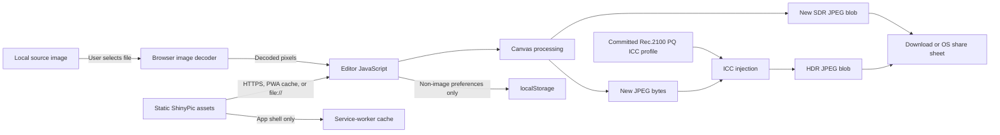

# ShinyPic threat model

This document describes the security and privacy boundaries of the current
static application. It is intended to make trade-offs reviewable, not to claim
that the application or its hosting is invulnerable.

## System and data flow



The live deployment and the standalone build run the same editor locally. A
selected file is decoded by the browser and referenced with a temporary object
URL. Pixel processing, PQ encoding, JPEG encoding, ICC injection, preview, and
export happen in the page. ShinyPic has no application backend or image-upload
API.

The hosted application still has a critical trust boundary: code downloaded
from the host executes in the page and can access a selected image. “Local
processing” is meaningful only when the delivered code, browser, and device are
trusted.

## Assets to protect

| Asset | Why it matters |
| --- | --- |
| Source pixels | May reveal faces, documents, locations, screens, or other private details. |
| Source metadata and filename | May contain GPS coordinates, timestamps, names, device details, or workflow information. |
| Exported image | May retain visible sensitive details and may be shared beyond the intended audience. |
| Editor preferences | Low sensitivity, but reveal recent colour and editing choices on a shared browser profile. |
| Application integrity | Modified JavaScript could copy a selected image or falsify export behavior. |
| Build and source integrity | A compromised maintainer account or CI action could alter the deployed application. |

## Trust boundaries

1. **Static host and deployment pipeline.** Cloudflare, repository access,
   GitHub Actions, and maintainer credentials determine which code is served.
2. **Browser and operating system.** Image decoding, canvas/JPEG encoding,
   colour management, object URLs, download, caching, and native sharing are
   platform services.
3. **Input file.** The browser parses user-selected content. File extensions and
   MIME labels are not reliable proof that content is benign.
4. **Output destination.** A download folder, messaging client, photo library,
   social network, or another editor becomes a new data controller after export.
5. **Standalone copy.** A downloaded HTML file avoids future host changes, but
   users must still trust the specific file they obtained and the browser that
   opens it.

## Current controls

### Data minimization

- There is no account, application API, telemetry SDK, advertising tag, remote
  font, or server-side image workflow.
- Runtime image state stays in memory and browser-managed blobs. Source image
  bytes are not written to `localStorage`, IndexedDB, or the service-worker
  cache by the application.
- `localStorage` contains only a small set of editor settings. Private browsing,
  an opaque `file://` origin, or browser policy may disable it without breaking
  the editor.
- Uploads are restricted to recognised JPEG, PNG, WebP, AVIF, HEIC, and HEIF
  signatures. Declared MIME types are allowlisted; SVG, GIF, and unknown active
  or document formats are rejected before browser image decoding.
- Input size is capped at 30 MB. Decoded inputs are capped at 64 megapixels and
  16,384 pixels on either edge, and export dimensions/pixel counts are capped
  more conservatively on mobile to reduce accidental memory exhaustion.

### Metadata handling

The app draws decoded pixels to a canvas and creates a new JPEG rather than
modifying the source container. It does not copy source EXIF, GPS, XMP, IPTC,
thumbnails, comments, or application-specific blocks. The HDR path injects the
repository's Rec.2100 PQ ICC profile into that newly encoded JPEG.

This is metadata minimization, not anonymization:

- the exported filename is derived from the source filename;
- visible text, faces, reflections, landmarks, and screens remain in the
  pixels;
- the browser encoder may add its own format markers; and
- JavaScript cannot guarantee immediate erasure from process memory, swap,
  browser crash reports, filesystem download history, or backups.

Inspect an export before sharing it when the consequences of disclosure are
high.

### Supply-chain posture

- The runtime and build scripts currently use browser APIs and Node.js built-in
  modules, with no third-party npm packages.
- The Rec.2100 PQ ICC profile is committed for reproducibility. Its expected
  size, description, and SHA-256 digest are documented in
  `docs/HDR_PIPELINE.md` and checked by CI.
- CI has read-only repository permissions, a job timeout, no deployment
  credentials, and third-party actions pinned to full commit hashes.
- Generated `dist/` and `dist-single/` content is not committed. A deployment
  should be built from a reviewed commit.
- Dependabot proposes updates to pinned GitHub Actions. An update still requires
  human review before merge.

## Threats and residual risk

| Threat | Existing mitigation | Residual risk / operator action |
| --- | --- | --- |
| Hosted code exfiltrates a selected image | Small, reviewable static codebase; no runtime dependencies or intended upload endpoint | A compromised deployment can add an endpoint. Protect repository and Cloudflare accounts with phishing-resistant MFA, least privilege, branch protection, and deployment review. |
| Cross-site scripting or injected third-party code | No user HTML rendering, dynamic code execution, or third-party runtime script is intended | Enforce a restrictive hosted Content Security Policy and review any future DOM or URL construction. The single-file build necessarily uses inline code and needs a separate CSP strategy. |
| Malicious or malformed image exploits a decoder | MIME allowlist, raster-signature check, 30 MB input cap, and 64 MP / 16,384 px decoded bounds; browser provides the decoder | ShinyPic is not a file sandbox. Signature checks are not malware scanning, and a decoder must inspect enough of the file to expose dimensions. Use a maintained browser and do not open hostile files. Browser vulnerabilities can still crash or compromise a client. |
| Source metadata leaks into output | Export is newly canvas-encoded; source metadata blocks are not copied | Filename and visible pixel content can still identify the source. Verify representative exports independently after encoder changes. |
| Photo persists unexpectedly | No source persistence in application storage; object URLs are revoked when replaced | Browser memory, downloads, OS share sheets, swap, extensions, backups, and forensic artifacts are outside application control. Close the tab and follow device-level handling policy. |
| Service worker serves an old build | Cache is limited to the same-origin app shell | A client may remain on an older cached version. Bump cache identifiers for security releases and communicate when users should reload or clear site data. |
| Output is not truly HDR or is transformed | UI distinguishes an HDR-capable preview from an SDR simulation; SDR export is available | Display and receiving-app behavior is platform-dependent. Do not use brightness as an authenticity or safety signal. Preserve the original separately. |
| Denial of service from a very large image | 30 MB input cap, 64 MP / 16,384 px decoded bounds, plus device-aware export limits | Highly compressed images may expand before dimensions are rejected. A tab can still run out of memory, especially on mobile. |
| Sensitive data sent through native sharing | Sharing requires a user action and invokes the OS share sheet | The chosen app may upload, retain, analyze, or transcode the file. Destination policy is outside ShinyPic. |

## Non-goals

ShinyPic does not provide:

- anonymity, identity protection, steganography, or plausible deniability;
- malware scanning or safe parsing of adversarial files;
- secure deletion, memory zeroization, or forensic resistance;
- end-to-end encryption or access control for exported files;
- proof that a recipient displayed the HDR signal accurately; or
- protection from a compromised browser, extension, device, operating system,
  static host, repository, maintainer, or sharing destination.

## Deployment checklist

- Require phishing-resistant MFA for GitHub and Cloudflare accounts.
- Protect the default branch, require review and passing CI, and restrict who
  can modify workflows or deployment configuration.
- Give CI read-only permissions; keep deployment credentials out of pull-request
  workflows and use short-lived, narrowly scoped credentials where possible.
- Build the static artifact from a reviewed commit. Record the commit identifier
  with the deployment and keep audit logs.
- Serve HTTPS only. Configure a restrictive Content Security Policy, deny
  framing unless explicitly needed, set `X-Content-Type-Options: nosniff`, a
  conservative `Referrer-Policy`, and a narrowly scoped `Permissions-Policy`.
- Do not enable Cloudflare Web Analytics, browser insights, third-party logging,
  or request-body capture without revisiting the privacy statement and consent
  model.
- Ensure caching rules do not cache user-specific responses if a backend is ever
  introduced. The current deployment should be static and content-identical for
  every visitor.
- Enable GitHub private vulnerability reporting and secret scanning where the
  repository plan supports them.
- Verify the live site after deployment, including absence of unexpected network
  requests during upload, edit, preview, export, and offline use.

## Verification examples

Run the same checks performed by CI:

```sh
npm test
npm run build
npm run build:single
shasum -a 256 -c checksums.sha256
```

For a release, test both `dist/index.html` through a local static server and
`dist-single/index.html` directly over `file://`. In browser developer tools,
confirm that selecting and exporting a photo creates no unexpected network
requests. Use only synthetic media for screenshots, reports, and test fixtures.

## Review cadence

Revisit this model whenever the application adds a dependency, accepts a new
media type, changes browser storage, adds a network request, changes metadata
handling, introduces server-side behavior, or modifies the deployment pipeline.
